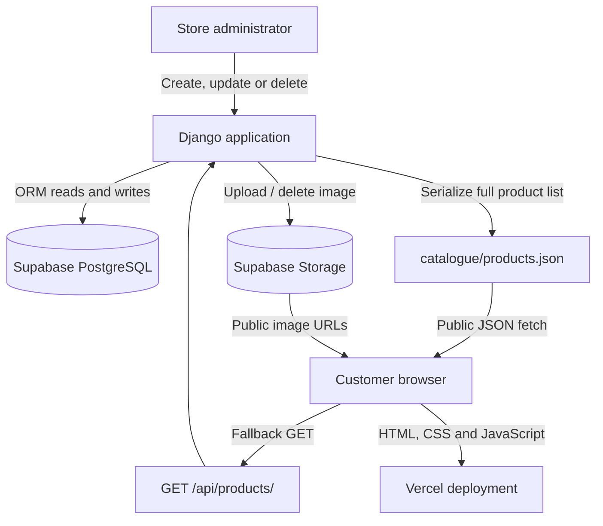

# Ngqo Perfumes

A Django-powered digital fragrance catalogue built to solve a real problem for a small family perfume business.

<p align="center">
  <a href="https://ngqoperfumes.vercel.app"><strong>Live application</strong></a>
  ·
  <a href="https://github.com/Olwethu-Tshabalala16/NgqoPerfumes"><strong>Source code</strong></a>
</p>

Ngqo Perfumes replaces a manually shared product catalogue with a single, shareable website. Customers can browse fragrances, search the collection, view product details, prices, availability and product images. Product information is managed through Django Admin, while Supabase provides persistent database and object-storage infrastructure.

> **Project status:** Deployed on Vercel. The current scope is a product catalogue with administrative product management; it is not yet a complete e-commerce checkout or payment platform.

---

## Table of contents

- [Overview](#overview)
- [Features](#features)
- [Architecture](#architecture)
- [Technology stack](#technology-stack)
- [Repository structure](#repository-structure)
- [Data model and catalogue format](#data-model-and-catalogue-format)
- [Run locally](#run-locally)
- [Environment variables](#environment-variables)
- [Database and storage setup](#database-and-storage-setup)
- [Tests and continuous integration](#tests-and-continuous-integration)
- [Deploy to Vercel](#deploy-to-vercel)
- [Operational notes](#operational-notes)
- [Security considerations](#security-considerations)
- [Engineering decisions and learning](#engineering-decisions-and-learning)
- [Roadmap](#roadmap)

## Overview

The project began with a practical problem. My mother was running a small perfume business and relied on printed or manually shared catalogues to show customers the available products. I built Ngqo Perfumes to make that catalogue accessible through one link.

The application has since developed into a small full-stack system. It combines a Django application, a relational database, object storage, a static customer-facing interface and a deployment pipeline.

The project is useful as a demonstration of how a relatively small business requirement can lead to real engineering concerns: data persistence, file storage, API design, deployment configuration, cache invalidation and consistency between an administrative system and a public-facing catalogue.

## Features

### Customer-facing catalogue

- Responsive fragrance catalogue built with HTML, CSS and vanilla JavaScript.
- Search products by name and description.
- Open a product detail dialog to view its description, price, image and stock status.
- Display prices in South African rand (ZAR).
- Lazy-load product images.
- Light and dark theme support, including remembered visitor preferences.
- Display a useful empty state and retry option when catalogue data cannot be loaded.

### Product administration

- Django Admin is used to create, update, search and delete products.
- Product records include a name, description, price, stock quantity and optional image.
- Saving or deleting a product republishes the complete catalogue to a fixed JSON object in Supabase Storage.
- Bulk deletion through Django Admin also republishes the catalogue.
- Product image cleanup checks whether another product still references the same image before deleting it.

### Backend and infrastructure

- Django serves the customer-facing page, admin interface and JSON API.
- PostgreSQL stores structured application data.
- Supabase Storage stores product images and the generated catalogue snapshot.
- The frontend reads the public JSON catalogue in production and falls back to the Django products API if that source is unavailable.
- Catalogue responses are configured to avoid stale browser and CDN cache results.
- Vercel deploys the Django application and serves collected static assets.
- GitHub Actions runs Django checks, tests, frontend syntax checks and deployment-configuration validation.

## Architecture

The application separates structured product data from image files and the public catalogue snapshot.



### Catalogue publishing flow

1. An administrator creates, edits or deletes a product in Django Admin.
2. Django persists the product change in PostgreSQL.
3. The admin integration builds a fresh snapshot of all current products.
4. Django overwrites the single object at `catalogue/products.json` in Supabase Storage.
5. The storefront fetches that JSON snapshot and renders the current catalogue.
6. If the JSON source cannot be loaded, the frontend attempts the Django products API.

The catalogue JSON is a generated read model for the storefront. PostgreSQL remains the structured source of truth for product records.

### Product image lifecycle

Images are stored separately from the JSON catalogue. When a product is deleted, a Django `post_delete` signal checks whether another product references the same image. It removes the image only when no remaining product uses it. If remote image deletion fails, the database deletion is not rolled back; the failure is written to the application log for investigation.

## Technology stack

| Layer | Technology | Responsibility |
|---|---|---|
| Backend | Python 3.13 | Application language |
| Web framework | Django 6.1 | Routing, ORM, admin and server-side application |
| Database | PostgreSQL | Persistent product and application records |
| Object storage | Supabase Storage (S3-compatible API) | Product images and catalogue JSON |
| Frontend | HTML5, CSS3, vanilla JavaScript | Customer-facing catalogue |
| Storage integration | django-storages, boto3 | Django file storage through the S3-compatible interface |
| Database configuration | dj-database-url, psycopg2 | PostgreSQL connection configuration |
| Static assets | WhiteNoise / Vercel static delivery | Static-file handling |
| Hosting | Vercel | Django deployment and static asset delivery |
| CI | GitHub Actions | Automated checks and tests |

## Repository structure

```text
NgqoPerfumes/
├── .github/
│   └── workflows/
│       └── django.yml             # CI checks and automated tests
├── frontend/
│   ├── app.js                     # Catalogue rendering, search and API fallback
│   ├── config.js                  # Generated public frontend configuration
│   ├── index.html                 # Customer-facing page template
│   ├── styles.css                 # Storefront styles
│   └── theme.js                   # Theme preferences
├── nqoperfumes/
│   └── myshop/
│       ├── myshop/
│       │   ├── settings.py        # Django and infrastructure configuration
│       │   └── urls.py            # Application routes
│       ├── store/
│       │   ├── admin.py           # Product administration and catalogue publishing
│       │   ├── catalogue.py       # Catalogue JSON generation and publishing
│       │   ├── models.py          # Product model
│       │   ├── signals.py         # Unreferenced image cleanup
│       │   ├── storage.py         # Supabase S3-compatible storage backend
│       │   ├── tests.py           # Backend tests
│       │   ├── urls.py            # Store API routes
│       │   └── views.py           # Product API and health endpoint
│       └── manage.py
├── scripts/
│   └── build_vercel.py            # Generates public frontend configuration
├── .env.example                   # Environment variable template
├── manage.py                      # Repository-root Django entry point
├── pyproject.toml                 # Python dependencies and Vercel configuration
├── requirements.txt               # Pinned dependencies for pip and CI
├── vercel.json                    # Vercel function configuration
└── vercel_wsgi.py                 # WSGI entry point for Vercel
```

## Data model and catalogue format

The core domain model is `Product`.

| Field | Type | Purpose |
|---|---|---|
| `id` | Integer primary key | Product identifier |
| `name` | Character field | Fragrance name |
| `description` | Text field | Product description |
| `price` | Decimal | Product price |
| `stock` | Positive integer | Available stock quantity |
| `image` | Image field | Optional product image stored in Supabase |
| `created_at` | Date/time | Record creation timestamp |
| `updated_at` | Date/time | Last record update timestamp |

The generated catalogue is a JSON document with a version, update timestamp, product count and product collection. Each product entry includes its identifier, name, description, price, stock, stock availability, image URL and timestamps.

Example response shape:

```json
{
  "version": 1,
  "updated_at": "2026-01-01T12:00:00+00:00",
  "count": 1,
  "products": [
    {
      "id": 1,
      "name": "Example fragrance",
      "description": "Product description",
      "price": "499.00",
      "stock": 5,
      "is_in_stock": true,
      "image_url": "https://<project>.supabase.co/storage/v1/object/public/<bucket>/products/example.jpg",
      "created_at": "2026-01-01T10:00:00+00:00",
      "updated_at": "2026-01-01T10:00:00+00:00"
    }
  ]
}
```

The values above are illustrative, not live product data.

## Run locally

### Prerequisites

- Python 3.13
- pip
- Git
- A Supabase project if you want to test PostgreSQL and remote image/catalogue storage

### 1. Clone the repository

```bash
git clone https://github.com/Olwethu-Tshabalala16/NgqoPerfumes.git
cd NgqoPerfumes
```

### 2. Create and activate a virtual environment

Linux / macOS:

```bash
python3.13 -m venv .venv
source .venv/bin/activate
```

Windows PowerShell:

```powershell
py -3.13 -m venv .venv
.venv\Scripts\Activate.ps1
```

### 3. Install dependencies

```bash
python -m pip install --upgrade pip
python -m pip install -r requirements.txt
```

### 4. Configure environment variables

Copy the example file:

```bash
cp .env.example .env
```

Set the Django and Supabase values in `.env`. Do not commit this file.

### 5. Apply migrations and create an administrator

```bash
cd nqoperfumes/myshop
python manage.py migrate
python manage.py createsuperuser
```

### 6. Start the development server

```bash
python manage.py runserver
```

Open the application at:

- Storefront: http://127.0.0.1:8000/
- Django Admin: http://127.0.0.1:8000/admin/
- Product API: http://127.0.0.1:8000/api/products/
- Health check: http://127.0.0.1:8000/api/health/

The Django template serves the customer-facing page and its static assets. A separate frontend development server is not required for the normal local workflow.

## Environment variables

The repository includes `.env.example`. The table below describes the main configuration values.

| Variable | Purpose |
|---|---|
| `DJANGO_SECRET_KEY` | Secret key used by Django |
| `DJANGO_DEBUG` | Enables/disables Django debug mode; disable in production |
| `DJANGO_ALLOWED_HOSTS` | Comma-separated allowed hostnames |
| `CSRF_TRUSTED_ORIGINS` | Comma-separated trusted origins including scheme |
| `CORS_ALLOWED_ORIGINS` | Allowed origins for API requests |
| `DATABASE_URL` | PostgreSQL connection URL; SQLite is used when absent for local development |
| `SUPABASE_URL` | Supabase project URL |
| `SUPABASE_STORAGE_BUCKET` | Storage bucket used for product images and catalogue JSON |
| `SUPABASE_STORAGE_ENDPOINT` | Supabase S3-compatible Storage endpoint |
| `SUPABASE_STORAGE_REGION` | S3-compatible region value |
| `SUPABASE_STORAGE_ACCESS_KEY_ID` | Server-side S3 access key |
| `SUPABASE_STORAGE_SECRET_ACCESS_KEY` | Server-side S3 secret |

The example configuration uses `product-images` as the bucket name. The deployed environment may use a different bucket name; the value must match the bucket configured in Supabase and in the Vercel environment variables.

The Vercel build script generates `frontend/config.js` from `SUPABASE_URL` and `SUPABASE_STORAGE_BUCKET`. This file contains public catalogue configuration only. It must never contain database passwords, Django secrets or S3 credentials.

## Database and storage setup

Ngqo Perfumes uses two Supabase services:

### PostgreSQL

Set `DATABASE_URL` to the connection string for your Supabase PostgreSQL database. For serverless deployments, use the connection method recommended by Supabase for your hosting environment (typically the transaction pooler). URL-encode special characters in credentials where required.

### Supabase Storage

Create a bucket and set `SUPABASE_STORAGE_BUCKET` to its name. The same bucket stores:

- Product image objects under `products/`.
- The generated catalogue at `catalogue/products.json`.

The bucket must allow public downloads for the current public image and catalogue URLs to work. S3 access credentials remain private and are used by the Django backend for writes and deletes.

After configuring the services, apply Django migrations and create an administrator. Add or update a product in Django Admin to publish the initial catalogue snapshot.

## Tests and continuous integration

Run the backend checks from `nqoperfumes/myshop/`:

```bash
python manage.py check
python manage.py test
```

The GitHub Actions workflow also validates the Vercel configuration, checks that `pyproject.toml` and `requirements.txt` dependency lists match, collects static files, checks Python and JavaScript syntax, and runs the automated Django test suite.

To check the frontend JavaScript syntax locally:

```bash
node --check frontend/app.js
node --check frontend/config.js
```

## Deploy to Vercel

The repository is configured for Vercel's native Django deployment.

Important project settings:

- **Root Directory:** repository root.
- **Framework Preset:** Django or Auto Detect.
- **Build Command:** `python scripts/build_vercel.py`.
- **Output Directory:** leave the override blank.
- **Install Command:** use the default dependency installation based on the project configuration.

Configure the environment variables from the previous section in the Vercel project for the required environments (Production and Preview). At minimum, production requires a strong `DJANGO_SECRET_KEY`, `DJANGO_DEBUG=False`, a valid `DATABASE_URL`, and the Supabase Storage settings.

Before using a new production database, run migrations and create the admin user from a trusted environment configured with the production database credentials:

```bash
cd nqoperfumes/myshop
python manage.py migrate
python manage.py createsuperuser
```

Then deploy the intended branch and verify:

| Route | Expected result |
|---|---|
| `/` | Customer-facing catalogue |
| `/admin/` | Django Admin login |
| `/api/products/` | Product JSON API |
| `/api/health/` | JSON health response |
| `/static/styles.css` | Storefront stylesheet |

The Vercel function filesystem is ephemeral. Do not rely on it for persistent product records or uploaded images; use PostgreSQL and Supabase Storage.

## Operational notes

- The PostgreSQL database is the source of truth for product records. The JSON file is a generated snapshot for the public storefront.
- A successful database save and a successful catalogue publish are separate operations. Django Admin reports a publishing error if the JSON update fails; check application logs and Supabase Storage configuration.
- The frontend requests the catalogue with browser caching disabled and a unique query parameter to avoid stale catalogue responses.
- Product image deletion is best-effort. If Supabase rejects a delete request, the database deletion remains complete and the cleanup error is logged.
- Django signals run for ORM deletions. Changes made directly in SQL bypass Django signals and do not trigger image cleanup or catalogue publishing.
- The current product deletion signal protects shared image references, but it does not perform a historical sweep of orphaned objects.

## Security considerations

- Never commit `.env`, database credentials, S3 secrets or `DJANGO_SECRET_KEY`.
- Keep Supabase S3 credentials on the server. Never expose them through `frontend/config.js`, browser JavaScript or public source files.
- Public bucket access is intentional for public product images and the storefront catalogue. Do not store private documents or sensitive user data in that bucket.
- Use `DJANGO_DEBUG=False` in production and configure allowed hosts and trusted origins for any custom domain.
- Rotate any credential that is accidentally exposed.

## Engineering decisions and learning

Several implementation choices are worth highlighting:

**A relational database for structured records.** Product attributes such as names, prices and stock quantities belong in PostgreSQL rather than being maintained only in a static file.

**Object storage for media.** Product images are stored outside the application runtime, so deployments do not depend on a persistent local filesystem.

**A generated JSON read model.** The storefront can retrieve a complete catalogue snapshot without requiring every visitor to query the database directly. The Django API remains available as a fallback.

**Explicit cache invalidation.** A mutable catalogue must not be treated like an immutable image asset. The publisher sets no-cache metadata, and the frontend avoids reusing cached catalogue responses.

**Lifecycle-aware file cleanup.** Deleting a product should not delete an image still used by another product. The deletion signal checks remaining references before attempting storage cleanup.

The project has been a practical exercise in connecting backend development, data persistence, cloud storage, deployment configuration and operational reliability.

## Roadmap

Potential next steps include:

- Add an order-request workflow.
- Introduce customer-facing enquiry and contact flows.
- Improve inventory audit history and stock management.
- Add structured logging and operational monitoring for catalogue publishing and storage cleanup.
- Add integration tests for database and storage workflows.
- Review and strengthen database access policies as the application grows.

These are planned improvements, not features currently represented as complete.

---

**Built to solve a real problem, and developed to explore practical full-stack engineering.**
